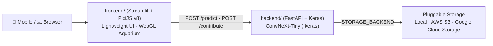

<p align="center">
  
</p>

<h1 align="center">🐟 FishID Studio</h1>

<p align="center">
  🇧🇷 <a href="README.md">Português</a> &nbsp;·&nbsp; 🇺🇸 <strong>English</strong>
</p>

<p align="center">
  
  &nbsp;&nbsp;&nbsp;&nbsp;&nbsp;
  
</p>

<p align="center">
  <strong>Master's Research in Applied Computing · UNIVALI · LEMA (Laboratory of Applied Marine Studies)</strong><br/>
  Deep Learning &amp; Electronic Monitoring Platform for Marine Pelagic Fish Identification and Biometrics<br/>
  <strong>Author:</strong> <a href="https://github.com/viniciusscience"><strong>José Vinícius da Silva de Souza</strong></a> &nbsp;·&nbsp; <strong>Co-author &amp; Advisor:</strong> <a href="https://github.com/rodrigosantana"><strong>Prof. Dr. Rodrigo Sant'Ana</strong></a>
</p>

<p align="center">
  
  
  
  
  
  <a href="https://github.com/viniciusscience/fishid-studio/actions/workflows/ci.yml"></a>
  <a href="https://doi.org/10.5281/zenodo.24451918"></a>
  `n  <a href="https://github.com/sponsors/viniciusscience"></a>
</p>

**FishID Studio** is an open-source computer vision platform for **automated identification, counting, and curved-body biometrics of large migratory pelagic fish** from photos, mobile cameras, and onboard fishing vessel videos. Born as a Master's thesis in Applied Computing at **UNIVALI / LEMA**, it combines scientific rigor (*ConvNeXt-Tiny*, *Grad-CAM* explainability, *YOLO-World + SAM 2.1* auto-segmentation, and *ByteTrack* multi-object tracking) with a responsive **PixiJS v8 WebGL** interface designed for researchers, fisheries electronic monitoring (EM), and citizen science.

API guide: [batch predictions, image privacy, duplicate contributions and statistics](docs/api-contributions.md).

---

## 🐟 Real-Time Automated Species Classification

Automated classification across **10 large migratory pelagic species** (tunas, billfishes, swordfish, and dolphinfish) returning common name, scientific name, taxonomic group, and Top-3 probability ranking:

<p align="center">
  
</p>

---

## 🎬 Real-World Demo — Onboard Electronic Monitoring (EM) & Biometrics

Automated analysis of real fishing vessel deck footage (**Electronic Monitoring — EM**), delivering **occlusion-aware consolidated fish counts**, **end-to-end curved body length measurement along the spine**, **estimated measurement uncertainty (±%)**, and **interactive `px ↔ cm` calibration**:

<p align="center">
  
</p>

<p align="center">
  <br/>
  <sub><i>Daytime haul visual audit: automatic full-body contour segmentation and spine centerline curve.</i></sub>
</p>

<p align="center">
  <br/>
  <sub><i>Nighttime haul visual audit: high-quality measurement (±3.2%) with 0% occlusion.</i></sub>
</p>

---

## 🌊 Interactive WebGL Aquarium UI

The interface features a **60 FPS WebGL** aquarium built with **PixiJS v8** and deformable meshes (`PIXI.MeshRope`), where photorealistic pelagic species swim with organic tail undulation, caustic light rays, and rising micro-bubbles behind translucent studio panels:

| Blue Marlin (*Makaira nigricans*) | Sailfish (*Istiophorus platypterus*) | Dolphinfish / Mahi-mahi (*Coryphaena hippurus*) | Yellowfin Tuna (*Thunnus albacares*) |
| :---: | :---: | :---: | :---: |
|  |  |  |  |

---

## 🌍 Alignment with UN Sustainable Development Goals (2030 Agenda)

This research contributes directly to the United Nations **Sustainable Development Goals (SDGs)**:

- **🌊 SDG 14 — Life Below Water:** supports conservation and sustainable use of marine resources by enabling automated taxonomic monitoring of large migratory species and helping combat illegal, unreported, and unregulated (IUU) fishing.
- **⚙️ SDG 9 — Industry, Innovation, and Infrastructure:** brings state-of-the-art open-source computer vision to fisheries monitoring and marine science.
- **♻️ SDG 12 — Responsible Consumption and Production:** strengthens species traceability and transparency across seafood supply chains.

---

## 🐠 Supported Species (10 Pelagic Species)

The current model was trained on **6,200+ images** covering 10 large migratory marine species:

| # | Common Name (EN) | Common Name (PT-BR) | Scientific Name | Group |
| :-: | :--- | :--- | :--- | :--- |
| 1 | **Dolphinfish (Mahi-mahi)** | Dourado-do-mar | *Coryphaena hippurus* | Pelagic |
| 2 | **Sailfish** | Agulhão-vela (Peixe-vela) | *Istiophorus platypterus* | Billfish |
| 3 | **White Marlin** | Agulhão-branco (Marlim-branco) | *Kajikia albida* | Billfish |
| 4 | **Skipjack Tuna** | Bonito-listrado | *Katsuwonus pelamis* | Tuna |
| 5 | **Blue Marlin** | Agulhão-negro (Marlim-azul) | *Makaira nigricans* | Billfish |
| 6 | **Longbill Spearfish** | Agulhão-verde (Bico-longo) | *Tetrapturus pfluegeri* | Billfish |
| 7 | **Albacore Tuna** | Albacora-branca | *Thunnus alalunga* | Tuna |
| 8 | **Yellowfin Tuna** | Albacora-laje | *Thunnus albacares* | Tuna |
| 9 | **Bigeye Tuna** | Albacora-bandolim | *Thunnus obesus* | Tuna |
| 10 | **Swordfish** | Espadarte (Meca) | *Xiphias gladius* | Billfish |

---

## ✨ Key Features

- **🌊 Realistic WebGL Aquarium (`PixiJS v8`):** articulated photorealistic pelagic fish via `MeshRope`, 3 depth layers, caustic light rays, and micro-bubble columns.
- **📸 Mobile Camera & Upload Support:** responsive UI built for fast field, vessel, and lab use.
- **🐠 Interactive Species Gallery:** on-demand browsing with species filtering and instant random demo sampling.
- **🎥 Video Analysis (MP4 / MOV):** automated frame-by-frame OpenCV annotation, H.264 transcoding via `ffmpeg`, per-species summary, and annotated video export.
- **📊 Electronic Monitoring (EM) — Counting & Biometrics:** dedicated tab for auditing long fishing-vessel videos (`monitoramento_em.py`), with occlusion-aware consolidated counts, curved length estimation with uncertainty (`±%`), species class, interactive `px → cm` calibration, visual audit gallery (`SAM 2.1` + spine curve), and HUD video export.
- **🤝 Continuous Learning with Automated Quality Gate:** automatic sharpness, brightness, contrast, and resolution checks (`backend/storage.py`) routing images to confirmed vs. human-review buckets across pluggable backends (**Local**, **AWS S3 / R2**, or **Google Cloud Storage**).
- **🔬 Reproducible Scientific Pipeline:**
  - `ConvNeXt_Tiny_Otimizado_Mestrado.ipynb` — aspect-ratio-preserving preprocessing (`resize_with_pad`), `mixed_float16`, `CosineDecay`, `MixUp`, `TTA`, and comparative **Grad-CAM** explainability.
  - `segmentar_peixes_auto.py` — high-throughput batch auto-segmentation and cropping (`YOLO-World` + `SAM 2.1`, FP16, parallel I/O).
  - `rastrear_peixes_auto.py` — multi-fish video tracking (`YOLO-World` + `ByteTrack`), trajectory CSV export, and YOLO auto-labeling.
  - `monitoramento_em.py` — v5 Electronic Monitoring pipeline for long videos (`YOLOv8l-Worldv2` with `agnostic_nms` + `ByteTrack` + spatiotemporal consolidation + interior-point `SAM 2.1` refinement + `distanceTransform²` spine-ridge curved length measurement + HSV buoy false-positive filter + HUD video).
  - `rodar_suite_benchmark.py` — controlled 10-experiment benchmark suite (ablations, day/night scenes, and anti-false-positive stress tests) logged under `experimentos_em/`.

---

## 🏗️ Architecture



```text
fishid-studio/
├── backend/                               # FastAPI API + Keras model + collection pipeline
│   ├── main.py                            # /health, /info, /predict, and /contribute endpoints
│   ├── storage.py                         # Image quality gate + storage (local | s3 | gcs)
│   ├── requirements.txt                   # Backend dependencies
│   ├── Dockerfile                         # Backend container
│   └── models/                            # Place your modelo.keras file here
│
├── frontend/                              # Lightweight FishID Studio Web UI (no TensorFlow)
│   ├── app.py                             # Streamlit app + PixiJS v8 WebGL Aquarium
│   ├── requirements.txt                   # Lightweight frontend dependencies
│   ├── packages.txt                       # System packages (ffmpeg, fonts-dejavu-core)
│   ├── Dockerfile                         # Frontend container
│   ├── .streamlit/config.toml             # Clean Studio visual theme
│   └── assets/bg/*_real.png               # Photorealistic transparent fish sprites
│
├── docs/                                  # Demo GIFs and visual audit cards
├── docker-compose.yml                     # Local orchestration (frontend + backend)
├── .env.example                           # Clean environment variable template
├── ConvNeXt_Tiny_Otimizado_Mestrado.ipynb # Training & Grad-CAM analysis notebook
├── segmentar_peixes_auto.py               # Batch auto-segmentation (YOLO-World + SAM 2.1)
├── rastrear_peixes_auto.py                # Multi-fish video tracking (ByteTrack)
├── monitoramento_em.py                    # v5 EM pipeline (counting, curved biometrics & HUD)
├── rodar_suite_benchmark.py               # Controlled 10-experiment benchmark suite
├── CITATION.cff                           # Machine-readable academic citation metadata
└── LICENSE                                # MIT License & Copyright
```

---

## 💻 Running Locally (Docker)

1. Copy the environment variable template:

```bash
cp .env.example .env
```

2. Start the stack locally:

```bash
docker compose up --build
```

- **Web Interface:** `http://localhost:8080`
- **API / Swagger Docs:** `http://localhost:8000/docs`

> All integrations (`.keras` model path, `STORAGE_BACKEND=local|s3|gcs`, optional gallery, contacts, and research support links) are configured strictly via your local `.env` file (git-ignored).

---

## 🤝 Contributing, Sponsorship & Enterprise Consulting

Questions about datasets, `px ↔ cm` calibration, or adding new species? Start a thread in [GitHub Discussions](https://github.com/viniciusscience/fishid-studio/discussions) or read [CONTRIBUTING.md](CONTRIBUTING.md).

- ⭐ **Star the Repository:** If **FishID Studio** helps your research or computer vision workflow, please give it a ⭐ **Star on GitHub**!
- 💖 **Sponsor Open Marine Science:** Support continuous development and model hosting via **[GitHub Sponsors](https://github.com/sponsors/viniciusscience)** — sponsors receive priority feature requests and recognition in the README!

### 🏢 Custom R&D, Fine-Tuning & Fisheries Electronic Monitoring (EM) Consulting
Looking to deploy **FishID Studio** in commercial fisheries, environmental agencies, vessel fleets, or marine conservation programs? We provide consulting, custom AI engineering, and R&D partnerships:
- 🎯 **Custom Species Fine-Tuning:** Training and benchmarking `ConvNeXt`, `YOLO-World`, and `SAM 2.1` models on your regional fish catalogs or camera-trap datasets.
- 🚢 **Vessel Electronic Monitoring (EM) & Edge Deployment:** Deck camera `px ↔ cm` calibration, anti-occlusion video tracking pipelines, automated catch biometry, and regulatory audit cards.
- 🔌 **Production API & Cloud Integration (`FastAPI` / `Docker` / `S3` / `GCS`):** High-throughput video batch processing and citizen-science collection portals.
- 📬 **Get in touch:** [LinkedIn — José Vinícius](https://www.linkedin.com/in/viniciecomp/) · [GitHub Discussions](https://github.com/viniciusscience/fishid-studio/discussions) · [GitHub Sponsors](https://github.com/sponsors/viniciusscience)

<p align="center">
  <a href="https://github.com/viniciusscience/fishid-studio/graphs/contributors">
    
  </a>
</p>

---

## 📈 Star History

<p align="center">
  <a href="https://star-history.com/#viniciusscience/fishid-studio&Date">
    <picture>
      <source media="(prefers-color-scheme: dark)" srcset="https://api.star-history.com/svg?repos=viniciusscience/fishid-studio&type=Date&theme=dark" />
      <source media="(prefers-color-scheme: light)" srcset="https://api.star-history.com/svg?repos=viniciusscience/fishid-studio&type=Date" />
      
    </picture>
  </a>
</p>

---

## 📖 Citation & References

```bibtex
@software{souza2026fishidstudio,
  author       = {José Vinícius da Silva de Souza and Rodrigo Sant'Ana},
  title        = {FishID Studio: Deep Learning e Monitoramento Eletrônico para Identificação e Biometria de Peixes Marinhos},
  year         = {2026},
  version      = {v1.0.0},
  publisher    = {Zenodo},
  doi          = {10.5281/zenodo.24451918},
  url          = {https://doi.org/10.5281/zenodo.24451918},
  institution  = {Universidade do Vale do Itajaí (UNIVALI) — Laboratório de Estudos Marinhos Aplicados (LEMA)}
}
```

- **Liu, Z. et al. (2022).** *A ConvNet for the 2020s (ConvNeXt).* IEEE/CVF CVPR.
- **Selvaraju, R. R. et al. (2017).** *Grad-CAM: Visual Explanations from Deep Networks via Gradient-based Localization.* ICCV.
- **Álvarez-Ellacuría, A. et al. (2019).** *Image-based, unsupervised estimation of fish size from commercial landings using deep learning.* ICES Journal of Marine Science.
- **Froese, R. (2006).** *Cube law, condition factor and weight-length relationships: history, meta-analysis and recommendations.* Journal of Applied Ichthyology, 22(4), 241–253.

---

## ©️ Copyright & License

**Copyright © 2026 José Vinícius da Silva de Souza and Rodrigo Sant'Ana (LEMA · UNIVALI).** Licensed under the **MIT License** ([LICENSE](LICENSE)).

- **Source code:** free for academic, educational, and commercial use, modification, and redistribution, **provided copyright notices and attribution to the authors, LEMA, and the UNIVALI Master's research are preserved**.
- **Datasets & images:** training images sourced from open repositories (such as *iNaturalist* and *FishBase*) remain subject to their original licenses. Photos voluntarily submitted via *"Continuous Learning"* are collected with explicit consent strictly for scientific research, model improvement, and species catalog expansion.
- **Technical disclaimer:** model predictions are intended for decision support and scientific monitoring and do not replace official taxonomic certifications in regulatory contexts.
